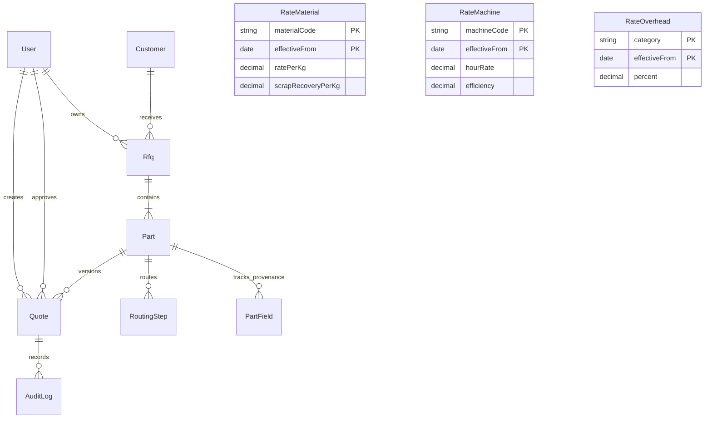
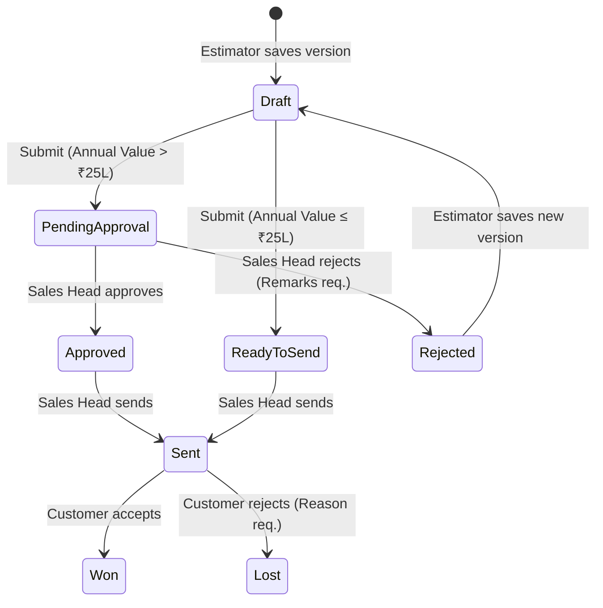

# Technical Design Document (TDD) — Quote Desk

**Project Name:** Quote Desk (RFQ Costing & Quotation Platform)  
**Client:** Company A, Chakan, Pune  
**GitHub Repository:** [https://github.com/Ctrl-apk/Quote-Desk](https://github.com/Ctrl-apk/Quote-Desk)  
**Author:** Shifa  
**Date:** November 2026  
**Status:** Shipped & Verified  

---

## 1. Executive Summary & Problem Framing

Company A is an automotive supplier in Chakan, Pune, manufacturing machined and forged components for two-wheeler, tractor, and Tier-1 customers. With 320 employees, ₹140–160 crore annual revenue, and an estimation team of 6 engineers, the company receives approximately 60 RFQs per month (averaging 5 parts each).

### The Problem
* **Labor Overhead:** Estimators spend 2.5 hours per part manually copying machine hour rates and material costs from an outdated ERP into Excel workbooks ($720 \text{ RFQs/yr} \times 5 \text{ parts} \times 2.5 \text{ hrs} = 9,000 \text{ hrs/yr} = \mathbf{₹40.5\text{ Lakh/yr}}$ in estimation labor).
* **Lost Orders:** Turnaround averages 9 working days against a 4-day customer expectation. 5% of RFQs (36/yr) are lost purely to late replies. At an average annual value of ₹20 Lakh and 12% contribution margin, this represents $36 \times ₹2.4\text{ Lakh} = \mathbf{₹86.4\text{ Lakh/yr}}$.
* **Total Business Impact:** **₹1.27 Crore annual loss**.
* **Audit & Drift Risk:** Quotes lack traceability to the exact rate masters in force on the quoting date.

### The Objective
Deliver a desktop-first, highly calm, dense costing application allowing an estimator to ingest an RFQ with pre-filled part details, complete multi-volume costing in under an hour, look up historical quotes for similar parts, preserve append-only rate master traceability, and enforce executive approval for large quotes ($> ₹25\text{ Lakh}$).

---

## 2. System Architecture & Component Design

The platform enforces a strict unidirectional dependency structure:

$$\text{UI Layer} \longrightarrow \text{Server Actions / API Handlers} \longrightarrow \text{Service Layer} \longrightarrow \text{Pure Domain Core} \longleftrightarrow \text{Persistence (PostgreSQL)}$$

```
┌────────────────────────────────────────────────────────────────────────┐
│                   Presentation Layer (Next.js 16 App Router)           │
│  - 9 Desktop-Optimised Screens (Density, Tabular Data, Watermelon UI)  │
│  - Dynamic Paired Role Views: Estimator vs. Sales Head                 │
└───────────────────────────────────┬────────────────────────────────────┘
                                    │
                                    ▼
┌────────────────────────────────────────────────────────────────────────┐
│                      Boundary & Authorization Layer                    │
│  - Edge Proxy Guard (`src/proxy.ts`): Session & path validation        │
│  - Server Action Guards (`src/server/guard.ts`): RBAC permission check │
│  - Input Validation: Strict Zod schemas on every action                │
└───────────────────────────────────┬────────────────────────────────────┘
                                    │
                                    ▼
┌────────────────────────────────────────────────────────────────────────┐
│                             Service Layer                              │
│  - `rfqs.ts`, `costing.ts`, `quotes.ts`, `rates.ts`, `past-quotes.ts`  │
│  - Concurrency management (Row-level transactional locks)              │
│  - Acceptance gate enforcement (AI-filled fields block submission)     │
└──────────────────┬──────────────────────────────────┬──────────────────┘
                   │                                  │
                   ▼                                  ▼
┌──────────────────────────────────────┐ ┌───────────────────────────────┐
│        Pure Mathematical Core        │ │       Persistence Layer       │
│  - `src/lib/cost-engine`             │ │  - PostgreSQL 16+ via Prisma  │
│  - `src/lib/rates`                   │ │  - Rust-free pg driver adapter│
│  - Zero side effects, no DB/AI deps  │ │  - Append-only DB triggers    │
│  - Exact `decimal.js` paise rounding │ │  - CHECK integrity constraints│
└──────────────────────────────────────┘ └───────────────────────────────┘
```

### Architectural Principles
1. **Mathematical Purity:** The calculation engine imports zero libraries from Next.js, React, or Prisma. Financial calculations are completely deterministic and unit-testable in isolation.
2. **AI Never Computes Money:** AI is restricted to unstructured text extraction. All costing arithmetic is executed by hardcoded, auditable algorithms.
3. **Database-Enforced Invariants:** Critical rules (rate immutability, net weight $\le$ gross weight, lost reasons) are enforced by database triggers and constraints, not just application code.

---

## 3. Mathematical & Costing Engine Specification

The costing engine calculates unit economics across **three volume tiers** simultaneously: $0.5\times$, $1\times$ (base annual volume), and $1.5\times$. All money figures are calculated with `decimal.js` and rounded half-up to paise (₹ 0.01).

### 3.1 Material Cost
$$\text{Bought Weight} = \text{Gross Weight} \times \left(1 + \frac{\text{Scrap Allowance } \%}{100}\right)$$
$$\text{Material Cost per Unit} = \text{round}\Big(\text{Bought Weight} \times \text{Material Rate} - (\text{Gross Weight} - \text{Net Weight}) \times \text{Scrap Recovery Rate}\Big)$$
* *Constraint:* If $\text{Recovery Rate} > \text{Material Rate}$, the system throws `RECOVERY_EXCEEDS_RATE` (prevents scrap credit from making material costs negative).
* *Constraint:* If $\text{Net Weight} > \text{Gross Weight}$, throws `NET_EXCEEDS_GROSS`.

### 3.2 Conversion Cost
$$\text{Operation Cost}_i = \frac{\text{Cycle Time (min)}_i}{60} \times \frac{\text{Machine Hour Rate}_i}{\text{Machine Efficiency}_i}$$
$$\text{Conversion Cost per Unit} = \text{round}\left(\sum_{i=1}^{n} \text{Operation Cost}_i\right)$$
* *Benchmark Check (Prompt Sample):* Rear wheel spindle on CNC-T1:
  $$\frac{3.2\text{ min}}{60} \times \frac{₹850}{1.0} = \mathbf{₹45.3333\dots} \xrightarrow{\text{round}} \mathbf{₹45.33}$$

### 3.3 Setup & Tooling Amortisation
One-off manufacturing preparation costs are amortised over each tier's specific piece volume:
$$\text{Tier Volume}_t = \max\Big(1, \text{round}(\text{Annual Volume} \times \text{Factor}_t)\Big), \quad \text{Factor}_t \in \{0.5, 1.0, 1.5\}$$
$$\text{Setup + Tooling Cost per Unit}_t = \text{round}\left(\frac{\text{Setup Cost} + \text{Tooling Cost}}{\text{Tier Volume}_t}\right)$$
*Result:* Economies of scale are transparently visible; per-piece cost drops as volume increases.

### 3.4 Overheads, Total Cost & Markup
$$\text{Overhead per Unit} = \text{round}(\text{Overhead } \% \times \text{Conversion Cost})$$
$$\text{Total Cost per Unit}_t = \text{Material} + \text{Conversion} + \text{Overhead} + \text{SetupTooling}_t + \text{Packing} + \text{Freight}_t$$
$$\text{Markup per Unit}_t = \text{round}(\text{Markup } \% \times \text{Total Cost}_t)$$
$$\text{Quoted Price per Unit}_t = \text{Total Cost}_t + \text{Markup}_t$$
*Note on Margin vs. Markup (Assumption F-18):* The prompt's formula $\text{Price} = \text{Cost} + \text{Margin}$ is implemented as markup on cost. The UI explicitly states *"Margin (markup on cost)"* to prevent estimator misinterpretation.

### 3.5 GST & Annual Value
$$\text{GST per Unit}_t = \text{round}(\text{GST } \% \times \text{Quoted Price per Unit}_t)$$
$$\text{Annual Value}_t = \text{Quoted Price per Unit}_t \times \text{Tier Volume}_t \quad (\text{strictly excluding GST})$$

### 3.6 Approval Threshold
$$\text{Requires Sales Head Approval} \iff \text{Annual Value}_{\text{tier}=1.0} > ₹25,00,000$$

---

## 4. Data Models & Database Integrity



### 4.1 Append-Only Immutability via Database Triggers
To eliminate retroactive rate tampering, the database installs PostgreSQL triggers:
```sql
CREATE FUNCTION reject_rate_change() RETURNS trigger AS $$
BEGIN
  RAISE EXCEPTION 'Rate table % is append-only: add a new row with a later effective date.',
    TG_TABLE_NAME USING ERRCODE = 'restrict_violation';
END;
$$ LANGUAGE plpgsql;

CREATE TRIGGER "RateMaterial_append_only" BEFORE UPDATE OR DELETE ON "RateMaterial"
FOR EACH ROW EXECUTE FUNCTION reject_rate_change();
```
*Matching triggers are applied to `RateMachine` and `RateOverhead`.*

### 4.2 Quote Snapshot Architecture
When an estimator saves a quote version:
* The exact row IDs used are recorded in `rateRowIds`.
* A deep copy of every rate's values is serialized into `ratesSnapshot`.
* Later additions of newer rates can never alter existing quotes.

### 4.3 Database CHECK Constraints
* `Part_values_chk`: Guarantees gross weight $> 0$, net weight $> 0$, net weight $\le$ gross weight, annual volume $> 0$, setup/tooling $\ge 0$.
* `Rfq_lost_requires_reason_chk`: Enforces that `status = 'lost'` must have a non-empty `lostReason`.
* `Quote_send_transitions`: Enforces that quotes can only transition through authorized state sequences.

---

## 5. AI Intake & Human-in-the-Loop Verification

### 5.1 Extraction Architecture
The application defines a unified interface:
```typescript
export interface ExtractionProvider {
  info: ProviderInfo;
  extract(email: string, ctx: ExtractionContext): Promise<Extraction>;
}
```
* **Production Mode:** Anthropic Claude (or configured LLM via `LLM_API_KEY`).
* **Safe Default Mode:** Built-in pattern-matching local extractor with zero external network calls.

### 5.2 NDA & Data Privacy Controls
Under customer NDAs, drawing and commercial data cannot be leaked:
1. **Drawing Scope:** Engineering drawing PDFs and CAD models are **not** parsed with OCR or sent to external models. Intake handles pasted email text and Excel part lists.
2. **On-Premise Privacy Gate:** External API calls are blocked unless `LLM_DATA_USE_APPROVED=yes` is set, confirming the vendor's data-retention terms comply with NDAs.
3. **Verbatim Text Evidence:** Every extracted field proposal must quote the exact words from the source email. The `verifyExtraction` step drops hallucinations automatically.

### 5.3 Acceptance Gate
The `PartField` table logs the provenance of every field (`source`: `email` | `excel` | `title_block` | `manual`, `aiFilled`: boolean, `accepted`: boolean).
* A quote **cannot be submitted** if any field has `aiFilled: true` and `accepted: false`.
* Estimators must review and click "Accept", or manually edit the value (which converts it to `manual` and `accepted: true`).

---

## 6. Workflow State Machine & Concurrency



### Concurrency & Transactional Safety
* **Advisory Locks on RFQ Numbers:** Generated via `pg_advisory_xact_lock` to ensure gap-free, non-colliding sequences (`RFQ-YYMM-NNN`) under concurrent creation.
* **Row-Level Locking:** All quote status transitions (`submit`, `approve`, `reject`, `send`) run inside a single transaction using `SELECT ... FOR UPDATE` on the Quote and RFQ rows. Race conditions and double-submits are rejected at the database level.

---

## 7. Customer Quotation PDF Generator

* Rendered server-side using `@react-pdf/renderer` in [`src/server/pdf/QuotePdf.tsx`](file:///c:/Users/ASUS/Downloads/quote-desk-final-v3.1/quote-desk/src/server/pdf/QuotePdf.tsx).
* **Gatekeeper:** Can only be downloaded once the quote status is `sent`. Requests for draft, pending, or rejected PDFs return HTTP 409 Conflict.
* **NDA & Commercial Protection:**
  * **Included:** Customer name, part name, material, 30-day validity, tiered unit prices, separate GST, annual values, and an itemised per-piece cost breakup (Material, Conversion, Setup/Tooling, Overheads, Packing/Freight).
  * **Suppressed:** Internal markup percentage, machine hour rates, scrap recovery amounts, internal comments, and audit logs are strictly withheld from the customer document.

---

## 8. Role-Based Access Control (RBAC)

Permissions live in a single centralized matrix in [`src/lib/auth/permissions.ts`](file:///c:/Users/ASUS/Downloads/quote-desk-final-v3.1/quote-desk/src/lib/auth/permissions.ts):

| Capability | Estimator | Sales Head |
| :--- | :---: | :---: |
| View RFQs, Costing, Quotes, Rates, Past Quotes | Yes | Yes |
| Create RFQs (Manual & Intake) | Yes | No |
| Edit Part Details & Accept AI Suggestions | Yes | No |
| Save Quote Versions & Submit for Approval | Yes | No |
| Approve or Reject Quotes ($> ₹25\text{L}$) | No | **Yes** |
| Send Quote to Customer | No | **Yes** |
| Mark RFQ as Won / Lost | Yes | No |
| Add Rate Master Versions | No | **Yes** |
| Run Past Quote Excel Import | Yes | No |
| Download Sent Quotation PDF | Yes | Yes |

---

## 9. Verification & Test Evidence

The solution was verified with 100% pass rates across all suites:

| Test Suite | Scope | Count | Result |
| :--- | :--- | :---: | :---: |
| **Pure Unit Tests** | Financial arithmetic, tiers, boundaries, date logic, permission matrix, schemas | 581 tests | **Pass (0 failures)** |
| **PostgreSQL Integration Tests** | Real database triggers, audit immutability, row locks, concurrent submissions | 72 tests | **Pass (0 failures)** |
| **Static Analysis** | Strict TypeScript check (`tsc --noEmit`) | Entire project | **Zero errors** |
| **Code Quality** | ESLint (`next/core-web-vitals` + TS rules) | Entire project | **Zero warnings** |
| **Layout & Responsiveness** | 9 screens across 4 breakpoints (375px, 768px, 1024px, 1280px) | 64 matrix runs | **0 horizontal overflows** |

---

## 10. Traceability of Client Sample Parts

All three parts from the client prompt were coded into the regression suite ([`tests/costing/client-sample-parts.test.ts`](file:///c:/Users/ASUS/Downloads/quote-desk-final-v3.1/quote-desk/tests/costing/client-sample-parts.test.ts)):

| RFQ No | Customer | Part | Material | Gross kg | Volume | Cycle (min) | Hour Rate | Conversion/pc | Approval (> ₹25L) |
| :--- | :--- | :--- | :--- | :---: | :---: | :---: | :---: | :---: | :---: |
| **RFQ-2611-014** | Company B | Rear wheel spindle | EN8 | 0.61 | 180,000 | 3.2 | ₹850 | **₹ 45.33** | **Required** |
| **RFQ-2611-019** | Company C | Hydraulic lift arm | 40Cr4 | 4.60 | 24,000 | 11.5 | ₹1,450 | **₹ 277.92** | **Required** |
| **RFQ-2611-023** | Company D | Gear blank | 20MnCr5 | 1.48 | 60,000 | 4.8 | ₹950 | **₹ 76.00** | **Required** |

---

## 11. Open Assumptions for Client Confirmation

Per [`docs/assumptions.md`](file:///c:/Users/ASUS/Downloads/quote-desk-final-v3.1/quote-desk/docs/assumptions.md), these items are highlighted for Company A's commercial alignment:
1. **Markup & Scrap Defaults (F-22):** Initial placeholders set to 10% markup and 2% scrap allowance. Editable per quote.
2. **Customer PDF Breakdown (Q-04):** The cost breakup displays Material, Conversion, Setup/Tooling, Overheads, Packing/Freight, stating that the commercial margin is not itemised.
